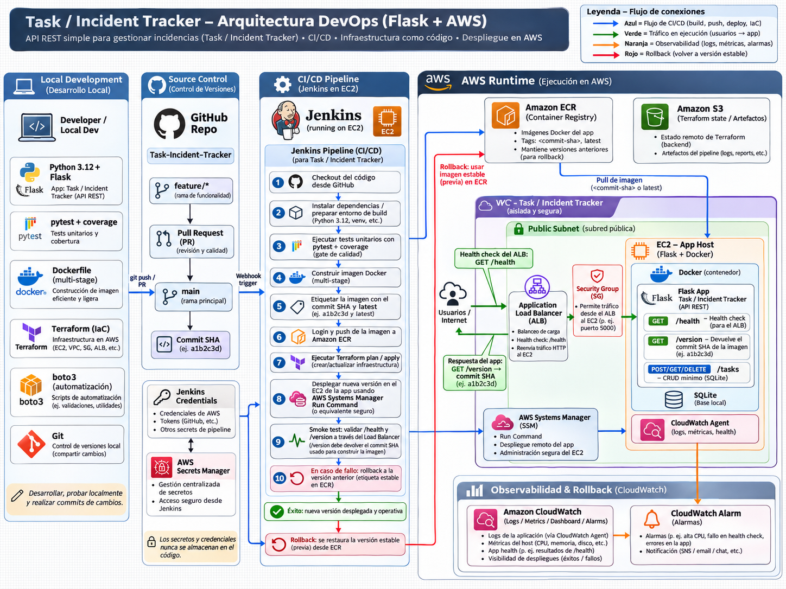

# Task / Incident Tracker — AWS DevOps Showcase

API REST mínima de gestión de incidencias, usada como pretexto para construir y defender un stack DevOps completo en AWS: **Docker, Terraform, Jenkins/CI-CD, Python/boto3, monitorización** — pensado para la entrevista de AWS DevOps Engineer.

> Si estás releyendo esto el día de la entrevista: empieza por el diagrama, baja por el "Cómo se construyó" en orden, y usa `docs/ARCHITECTURE.md` cuando necesites el detalle fino de una decisión concreta.

## Diagrama de arquitectura



**Nota importante**: este diagrama es el diseño original, dibujado *antes* de construir el proyecto — úsalo para la vista de pájaro, no como referencia exacta pieza por pieza. Durante la construcción, algunas decisiones evolucionaron (y está bien que así sea, es parte de la historia que se puede contar en la entrevista):

| En el diagrama | En la implementación final | Por qué |
|---|---|---|
| Dockerfile "multi-stage" | Dockerfile de una sola etapa | Las dependencias (Flask, Gunicorn) son Python puro sin compilación nativa; un segundo stage no reduce tamaño real |
| AWS Secrets Manager | No implementado en v1 | La app no tiene secretos reales que guardar todavía; documentado como la solución correcta si llegara a necesitarlos |
| Pipeline de 10 stages, incluye `terraform apply` | Pipeline de 7 stages + rollback, **sin** `terraform apply` | Darle a Jenkins permiso para tocar IAM/EC2/ALB rompería el mínimo privilegio de sus roles; la infra se gestiona aparte, con cadencia distinta a la de los despliegues de app |
| VPC propia aislada | VPC por defecto de la cuenta | Suficiente para el alcance de esta demo; evita gestionar NAT Gateways/rutas adicionales sin necesidad |
| Rollback a "la versión anterior" | Rollback al tag `:stable` en ECR (se mueve solo cuando un despliegue pasa el smoke test) | Así el rollback nunca depende de inspeccionar el estado del servidor remoto |

El resto —flujo CI/CD, ALB, SSM Run Command para despliegue sin SSH, CloudWatch para observabilidad— se construyó tal cual se diseñó.

## Qué cubre cada requisito de la oferta

| Requisito de la oferta | Dónde está en este repo |
|---|---|
| AWS | `infra/terraform/` — IAM, red, ALB, 2 EC2, 2 ECR, S3, CloudWatch, todo aplicado y verificado en una cuenta real |
| Jenkins / CI-CD | `Jenkinsfile` + Jenkins corriendo en su propia EC2, con imagen Docker propia (`jenkins/Dockerfile`) |
| Python (scripting) | `scripts/aws_housekeeping.py` — boto3, con tests (`moto`), probado contra la cuenta real |
| SDLC / Agile | `docs/AGILE.md` — branching, Definition of Done, y el propio desarrollo de este proyecto usado como ejemplo de sprint |
| IaC (valorable) | Terraform completo, backend remoto en S3 con locking nativo (sin DynamoDB) |
| Monitorización (valorable) | CloudWatch: logs reales de la app, métricas de host, dashboard, alarma de CPU |

## Cómo se construyó (orden real, no idealizado)

1. **App Flask** (`app/`) — endpoints `/health`, `/version`, `/tasks` (CRUD sobre SQLite). Tests con `pytest` (98% cobertura).
2. **Dockerfile** (`app/Dockerfile`) — imagen de una sola etapa, usuario no-root, Gunicorn como servidor WSGI, `GIT_SHA` inyectado en build time.
3. **Terraform — bootstrap** (`infra/terraform-bootstrap/`) — crea el bucket S3 que el módulo principal usará como backend remoto (con estado **local**, a propósito: es el único módulo así, por el problema de huevo-y-gallina de no poder usar como backend un bucket que el propio Terraform aún no ha creado).
4. **Terraform — principal** (`infra/terraform/`) — IAM (roles con `permissions_boundary`, restricción real de la cuenta de estudiante), red (Security Groups sin puerto 22 en ningún sitio), ALB, las 2 EC2, ECR (uno para la app, otro para la imagen propia de Jenkins), S3 de backups, CloudWatch.
5. **Jenkins** — contenedor arrancado desde una imagen propia (`jenkins/Dockerfile`, extiende la oficial con `docker`, `aws-cli`, `terraform`, `python3`), configurado a mano (usuario admin, job tipo Pipeline apuntando a este repo).
6. **`Jenkinsfile`** — pipeline de la app: checkout → tests → build+tag (commit SHA) → push a ECR → deploy en `app-server` vía SSM Run Command (sin SSH) → smoke test contra el ALB → marcar como `:stable` si todo pasó. Si algo falla, rollback automático al último `:stable`.
7. **`scripts/aws_housekeeping.py`** — automatización independiente de la app: `report` (qué instancias están corriendo y cuánto tiempo), `backup` (snapshot de las tareas actuales a S3), `stop-idle` (parar instancias que llevan demasiado tiempo corriendo, dry-run por defecto).
8. **Monitorización** — CloudWatch Agent (métricas de host) + Docker con `--log-driver awslogs` (logs de la app directos a CloudWatch, sin agente de por medio) + dashboard + alarma.

## Estructura del repo

```
app/                    App Flask + tests + Dockerfile
scripts/                Script Python/boto3 (housekeeping) + sus tests
jenkins/                Dockerfile de la imagen propia de Jenkins
infra/terraform/        Infraestructura principal (IAM, red, ALB, EC2, ECR, S3, CloudWatch)
infra/terraform-bootstrap/   Bootstrap del backend remoto de Terraform (estado local, único caso)
Jenkinsfile             Pipeline de CI/CD de la app
docs/ARCHITECTURE.md    Documento de referencia: cada decisión de arquitectura, con su porqué
docs/AGILE.md           Metodología, branching, Definition of Done
docs/architecture-diagram.png   Este mismo diagrama
```

## Para levantarlo de nuevo (orden de comandos)

```bash
# 1. Login a la cuenta de estudiante (credenciales temporales, caducan en horas)
#    copiar las credenciales nuevas en ~/.aws/credentials, perfil [estudiante]

# 2. Bootstrap del backend de Terraform (una sola vez, casi nunca cambia)
cd infra/terraform-bootstrap
terraform init && terraform apply
terraform output tfstate_bucket_name   # -> copiar a backend.hcl del módulo principal

# 3. Infraestructura principal
cd ../terraform
# rellenar backend.hcl (bucket real) y terraform.tfvars (tu IP real en allowed_ip)
terraform init -backend-config=backend.hcl
terraform plan   # revisar siempre antes de aplicar
terraform apply

# 4. Jenkins: entrar a http://<jenkins_server_public_ip>:8080, desbloquear,
#    crear usuario admin, crear job Pipeline -> "Pipeline script from SCM" ->
#    este repo, rama main, Script Path "Jenkinsfile"

# 5. Lanzar el pipeline desde la UI de Jenkins ("Construir ahora")
```

## Disciplina de coste

Esto genera coste real mientras esté arriba (2 EC2 + ALB). Al terminar una sesión de estudio:

```bash
cd infra/terraform
terraform destroy
```

El bootstrap (`infra/terraform-bootstrap/`) **no** hace falta destruirlo entre sesiones — es el bucket del tfstate, se reutiliza.

## Para profundizar

- **`docs/ARCHITECTURE.md`** — cada decisión de arquitectura explicada, con su "respuesta de entrevista" ya preparada (restricciones reales de la cuenta de estudiante, por qué no hay DynamoDB para el locking, por qué Terraform no está en el `Jenkinsfile`, qué pasaría en producción real, etc.)
- **`docs/AGILE.md`** — cómo se aplicó SDLC/Agile a este mismo desarrollo, con los impedimentos reales que surgieron (y cómo se diagnosticaron, no solo "se arreglaron")
