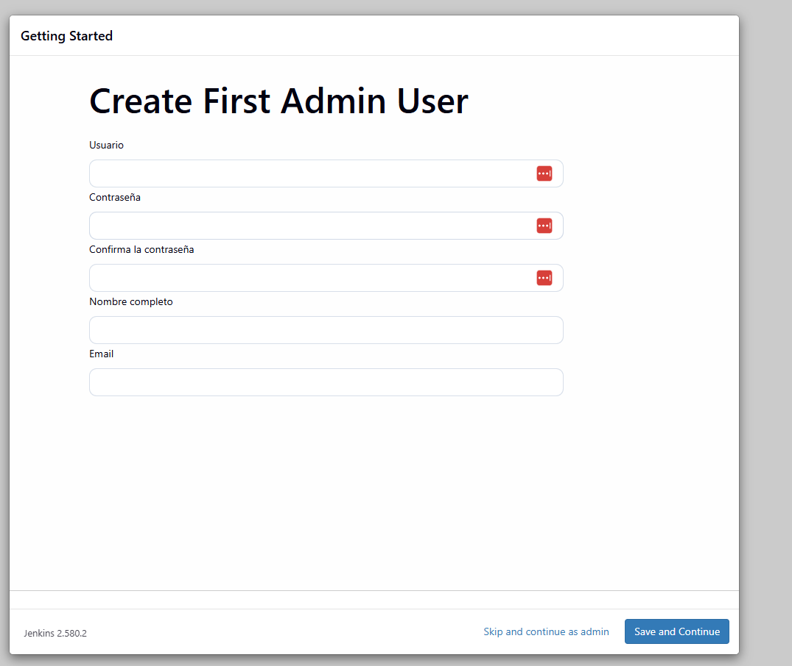
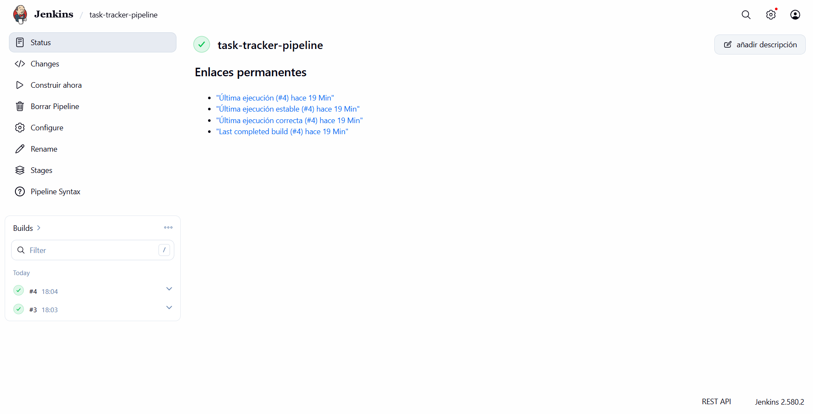

# Task / Incident Tracker — AWS DevOps Showcase

API REST mínima de gestión de incidencias, usada como base para construir un stack DevOps completo en AWS: contenerización con Docker, infraestructura como código con Terraform, CI/CD con Jenkins, automatización con Python/boto3 y monitorización con CloudWatch.

## Diagrama de arquitectura


**Dos matices frente al diagrama**, por si se comparan con el detalle de la implementación real:

- **VPC**: el diagrama agrupa todo bajo una caja "VPC (red del proyecto)" por claridad visual. En la implementación real se usa la **VPC por defecto de la cuenta**, no una VPC dedicada — suficiente para el alcance de este proyecto, evita gestionar NAT Gateways/rutas adicionales sin necesidad real.
- **ECR y S3** aparecen dentro de esa caja de VPC en el diagrama por agrupación visual, pero son servicios **regionales** de AWS, no recursos que vivan dentro de una VPC (salvo que se usen VPC endpoints, que no es el caso aquí).

El resto del diagrama —los 7 stages del pipeline, los dos roles IAM, los dos repos ECR, los dos buckets S3, el rollback al tag `:stable`, el flujo de logs/métricas— es fiel a la implementación real, no a un diseño idealizado.

---

## Arquitectura

### La app (`app/`)

- **Stack**: Python 3.14 + Flask 3.1, persistencia en SQLite local (vía `sqlite3` de la librería estándar, sin ORM).
- **Endpoints**:
  - `GET /health` — health check, usado por el ALB para decidir si la instancia recibe tráfico.
  - `GET /version` — devuelve `{"git_sha": "..."}`, el commit con el que se construyó la imagen en ejecución. El valor se lee de la variable de entorno `GIT_SHA`, inyectada en build time; sirve para que el pipeline verifique después de cada despliegue que la versión correcta está realmente corriendo.
  - `POST /tasks`, `GET /tasks`, `GET /tasks/<id>`, `DELETE /tasks/<id>` — CRUD mínimo de incidencias.
- **Tests**: `pytest` + `pytest-cov`, 15 tests, 98% de cobertura. Cada test usa una base de datos SQLite aislada y temporal (no comparten estado entre sí).
- **Frontend**: una página estática simple (`app/static/index.html`) servida desde la propia app — solo cosmética, no forma parte de lo evaluado ni de la API.

### Contenerización (`app/Dockerfile`)

```dockerfile
FROM python:3.14-slim
WORKDIR /app
ENV PYTHONDONTWRITEBYTECODE=1 PYTHONUNBUFFERED=1
COPY requirements.txt .
RUN pip install --no-cache-dir -r requirements.txt
RUN groupadd --system appgroup \
    && useradd --system --gid appgroup appuser \
    && chown appuser:appgroup /app
ARG GIT_SHA=dev
ENV GIT_SHA=${GIT_SHA}
COPY --chown=appuser:appgroup app.py ./
COPY --chown=appuser:appgroup static/ ./static/
USER appuser
EXPOSE 5000
CMD ["gunicorn", "--bind", "0.0.0.0:5000", "app:app"]
```

Decisiones concretas:
- **Una sola etapa**, no multi-stage: se evaluó multi-stage y se descartó a propósito porque las dependencias (Flask, Gunicorn) son Python puro sin compilación nativa — un segundo stage no reduce el tamaño real de la imagen. Multi-stage se reserva para dependencias que sí compilan (p. ej. librerías con extensiones en C).
- **Usuario no-root** (`appuser`): el proceso de la app nunca corre como root dentro del contenedor.
- **`chown appuser:appgroup /app` explícito**: sin esto, `WORKDIR /app` se crea como `root` *antes* de que el `USER appuser` tome efecto, y aunque `COPY --chown` cubre los ficheros copiados, no cubre el directorio en sí. Resultado real que se dio durante el desarrollo: `sqlite3.OperationalError: unable to open database file`, porque `appuser` no tenía permiso de escritura sobre `/app` para crear el fichero `.db`. El `chown` explícito al directorio lo arregla.
- **`GIT_SHA` como build-arg**: se inyecta en build time (`--build-arg GIT_SHA=<commit-sha>`) y queda grabado en la imagen vía `ENV`. Así `/version` siempre refleja fielmente con qué commit se construyó esa imagen concreta, sin depender de pasar variables de entorno en tiempo de ejecución.
- **Gunicorn** como servidor WSGI de producción, no el servidor de desarrollo de Flask.

### Infraestructura — Terraform (`infra/`)

**Restricción real de la cuenta de AWS usada** (cuenta de estudiante, IAM Identity Center): `iam:CreateRole` está denegado salvo que el rol creado tenga como *permissions boundary* la política gestionada `StudentBoundary` **y** su nombre empiece por `student-` (ese mismo prefijo es el único permitido para `iam:PassRole`). Todos los roles de este proyecto cumplen ambas condiciones.

**`infra/terraform-bootstrap/`** — módulo independiente, con **estado local a propósito** (es la única excepción deliberada a "todo en backend remoto"). Resuelve el problema de huevo-y-gallina de Terraform: no se puede usar como backend remoto un bucket S3 que el propio Terraform principal todavía no ha creado. Este módulo crea solo ese bucket (versionado, cifrado AES256, acceso público bloqueado) y se aplica una vez, casi nunca vuelve a cambiar.

**Locking del state sin DynamoDB**: el patrón clásico añadía una tabla DynamoDB solo para el *state locking*. Desde Terraform 1.10, el backend `s3` soporta locking nativo con `use_lockfile = true` (una escritura condicional dentro del propio bucket) — se usa esa opción en vez de montar una tabla DynamoDB aparte.

**`infra/terraform/`** — módulo principal, con backend remoto (ese bucket S3) configurado vía `-backend-config=backend.hcl` (el bloque `backend "s3" {}` se deja vacío en el código porque Terraform no permite variables ahí):

- **IAM** (`iam.tf`) — dos roles separados, no uno compartido: `student-jenkins-ec2-role` (SSM + permiso de *escritura* en ECR) y `student-app-ec2-role` (SSM + permiso de *lectura* en ECR + envío de métricas/logs a CloudWatch). Mínimo privilegio real. Además, una política inline (`jenkins-pipeline-deploy`) con exactamente los permisos que el `Jenkinsfile` necesita y que ningún managed policy cubre sin pasarse de amplio: `ec2:DescribeInstances` y `elasticloadbalancing:DescribeLoadBalancers` (para resolver instancia/ALB en tiempo de ejecución, sin hardcodear IDs), y `ssm:SendCommand`/`ssm:GetCommandInvocation` acotado por tag a la instancia `app-server`.
- **Red** (`network.tf`) — tres Security Groups. El del ALB abre el puerto 80 al mundo; el de `app-server` solo acepta su puerto desde el SG del ALB (nunca directo desde Internet); el de `jenkins-server` solo acepta el 8080 desde una IP concreta (la del estudiante, nunca `0.0.0.0/0`). **Ningún Security Group tiene el puerto 22 abierto** — el acceso a shell es vía AWS Systems Manager Session Manager.
- **ALB** (`alb.tf`) — en ≥2 subredes de AZs distintas (requisito de AWS para crear un ALB), listener HTTP:80, target group con health check en `/health`.
- **EC2** (`ec2.tf`) — dos instancias, cada una con su rol/instance profile. Ninguna tiene `key_name` (no hace falta, el acceso es vía SSM). `user_data_replace_on_change = true`: si cambia el script de arranque, Terraform destruye y recrea la instancia (no hay forma de "re-ejecutar" `user_data` en una instancia ya viva).
- **ECR** (`ecr.tf`) — dos repositorios: `task-tracker-app` (la app) y `task-tracker-jenkins` (la imagen propia de Jenkins, ver abajo). Política de lifecycle que expira imágenes sin tag tras 14 días.
- **S3** (`s3.tf`) — un único bucket de backups, usado solo por el script Python (sección siguiente), no como backend de Terraform.
- **CloudWatch** (`monitoring.tf`) — log group, dashboard (CPU de ambas instancias + requests/latencia del ALB) y alarma de CPU alta sobre `app-server`.

### CI/CD — Jenkins

**Imagen propia de Jenkins** (`jenkins/Dockerfile`), subida a su propio repositorio ECR y usada por la instancia `jenkins-server` en vez de la imagen oficial a pelo:

```dockerfile
FROM jenkins/jenkins:lts
USER root
RUN apt-get update \
    && apt-get install -y --no-install-recommends docker.io docker-cli curl unzip python3 python3-venv \
    && curl ... terraform ... \
    && curl ... awscli ...
USER jenkins
```

Por qué una imagen propia y no instalar herramientas a mano: la imagen oficial `jenkins/jenkins:lts` solo trae el servidor Jenkins (Java) — ni `docker`, ni `aws-cli`, ni `terraform`, ni `python3`. Instalarlos a mano dentro de un contenedor ya corriendo funciona, pero no es reproducible: si el contenedor se recrea, desaparecen y hay que reinstalarlos otra vez. Con una imagen propia versionada en ECR, cualquier instancia nueva arranca ya con todo listo.

**Un bug real encontrado al construirla**: la primera versión instalaba `docker.io` con `--no-install-recommends`. En Debian, el *cliente* de Docker (el binario `docker`) vive en un paquete aparte, `docker-cli`, que normalmente se instala como dependencia "Recommends" — ese flag lo excluyó. Resultado: `git`/`aws`/`terraform` funcionaban, pero `docker: command not found`. Se detectó comparando `dpkg -l` (decía `docker.io` instalado) contra `ls /usr/bin/docker*` (el binario no estaba), y se corrigió añadiendo `docker-cli` explícitamente a la lista de paquetes.

**Acceso al Docker del host desde dentro del contenedor de Jenkins** (patrón "Docker-outside-of-Docker"): se monta `/var/run/docker.sock` del host dentro del contenedor, y se arranca con `--group-add "$(stat -c '%g' /var/run/docker.sock)"` — sin esto, el usuario no-root `jenkins` no tendría permiso para hablar con ese socket, y los `docker build`/`docker push` del pipeline fallarían.

Configuración del job en Jenkins: tipo **Pipeline**, definición **"Pipeline script from SCM"** apuntando a este repositorio, rama `main`, Script Path `Jenkinsfile`.



### El pipeline — `Jenkinsfile`

**Credenciales AWS: ninguna configurada en Jenkins.** `jenkins-server` corre con el rol de instancia `student-jenkins-ec2-role`; cualquier `aws`/`docker login` del pipeline usa ese rol automáticamente vía el servicio de metadatos de EC2 (verificado con `docker exec jenkins aws sts get-caller-identity`, sin perfil ni claves).

Stages:

1. **Checkout** — descarga el código y resuelve en caliente, sin nada hardcodeado: el SHA del commit actual (`git rev-parse --short HEAD`), el ID de cuenta AWS (`sts get-caller-identity`), el ID de la instancia `app-server` y el DNS del ALB (por tag/nombre, vía `aws ec2 describe-instances` / `aws elbv2 describe-load-balancers`).
2. **Tests** — crea un entorno virtual de Python dentro del propio workspace, instala dependencias, corre `pytest --cov`. Si algún test falla, el pipeline se detiene aquí (gate de calidad) y no llega a construir ninguna imagen.
3. **Build & tag imagen Docker** — `docker build` usando el socket de Docker del host, imagen etiquetada **solo** con el commit SHA (nunca `latest`).
4. **Push a ECR** — login automático con el rol de la instancia, sube la imagen.
5. **Deploy a app-server (SSM)** — manda un comando remoto a `app-server` (sin SSH, vía `aws ssm send-command` con un documento `AWS-RunShellScript`) que hace login en ECR, `docker pull` de la imagen nueva, para el contenedor viejo y arranca el nuevo — con `--log-driver awslogs` para que sus logs vayan directos a CloudWatch (ver sección de Monitorización).
6. **Smoke test** — pregunta al ALB por `/health` y `/version`, reintentando hasta ~3 minutos (el target group tarda en marcar la instancia como sana tras un despliegue), hasta confirmar que el SHA desplegado es el esperado.
7. **Marcar como estable** — **solo si el smoke test pasó**, mueve el tag `:stable` en ECR a esta imagen.

Si cualquier stage falla, el bloque `post { failure { ... } }` hace **rollback automático**: vuelve a desplegar lo que `:stable` tenga en ese momento (la última versión que sí funcionó) y solo comprueba que `/health` vuelve a responder sano — no hace falta verificar el SHA exacto, porque `:stable` es por definición la última versión válida. Si todavía no existe ningún `:stable` (primer despliegue), el rollback se salta con un mensaje explicativo en vez de fallar intentando desplegar algo que no existe.

**Por qué Terraform NO está en este pipeline**: se consideró un stage de `terraform plan`/`apply` en cada build, pero se descartó. Darle a `jenkins-server` permisos para crear/modificar EC2, IAM o el ALB rompería el mínimo privilegio de sus dos roles; y la infraestructura cambia con poca frecuencia comparada con el código de la app, así que se gestiona aparte (manualmente, por quien administra la infra).

**Un bug real encontrado en la primera ejecución real del pipeline**: `AccessDeniedException` al intentar `ssm:SendCommand`, a pesar de que la política IAM ya incluía ese permiso. Causa: la política original metía el ARN del documento (`AWS-RunShellScript`) y el ARN de la instancia (con una condición de tag) en el **mismo** statement, compartiendo una sola condición. AWS evalúa el permiso por separado para cada recurso referenciado en la llamada — como el documento no tiene esa etiqueta, la condición fallaba para esa mitad y denegaba toda la acción. Se corrigió separando en dos statements: uno sin condición para el documento, otro con la condición de tag para la instancia.



### Automatización — `scripts/aws_housekeeping.py`

Script independiente de la app, con `boto3`, pensado para tareas típicas de "housekeeping" en una cuenta AWS real:

- `report` — lista las instancias EC2 del proyecto (por tag `Project`) con su estado, tipo y cuánto tiempo llevan corriendo.
- `backup` — pide el listado actual de tareas a la propia API de la app (a través del ALB) y lo sube a S3 como un JSON con timestamp. No lee la base de datos SQLite directamente (viviría en `app-server`); usar la API es más simple y no depende de cómo la app guarde sus datos por dentro.
- `stop-idle` — de ese mismo listado, identifica instancias que llevan corriendo más de N horas. **Dry-run por defecto** (solo dice qué pararía); hace falta `--confirm` para pararlas de verdad — pensado para no agotar crédito de cuenta sin querer.

Tests con `moto` (simula AWS sin tocar la cuenta real): filtrado por tag, subida a S3 y contenido correcto, backup contra una API simulada, y los dos modos de `stop-idle` (dry-run y confirmado). Verificado también contra la cuenta real: `report` lista las instancias de verdad, `backup` sube un JSON real a S3.

### Monitorización

CloudWatch Agent (métricas de host: CPU/memoria/disco) + logs de la app vía `docker run --log-driver awslogs` (Docker manda stdout/stderr directo a CloudWatch Logs, sin que el agente tenga que tailear ningún fichero) + dashboard + alarma de CPU alta.

**Dos bugs reales encontrados al verificar que esto funcionaba de verdad** (no solo que estuviera desplegado):

1. El JSON de configuración del CloudWatch Agent incluía `"region"` dentro de cada entrada de `logs.logs_collected.files.collect_list` — una propiedad no válida en esa posición para la versión del agente instalada (`Additional property region is not allowed`, encontrado ejecutando el traductor de configuración del propio agente para sacar un error más claro que el genérico "configuration validation first phase failed").
2. Aunque se arreglara el esquema, el agente estaba configurado para leer logs desde `/var/log/app/*.log` en el host — pero la app corre en un contenedor Docker que loguea a su propio stdout (capturado por el driver `json-file` por defecto), no a ningún fichero del host. Nada escribía ahí. Solución definitiva: en vez de hacer que el agente tailee ficheros, se cambió el `docker run` del despliegue para usar `--log-driver awslogs` directamente — Docker manda los logs a CloudWatch sin intermediarios.

Verificado tras el fix: `aws logs get-log-events` devuelve líneas reales de Gunicorn/la app, y `aws cloudwatch list-metrics` devuelve las métricas de CPU/memoria/disco del agente.

---

## Estructura del repo

```
app/                         App Flask + tests + Dockerfile + frontend estático
scripts/                     Script Python/boto3 (housekeeping) + sus tests
jenkins/                     Dockerfile de la imagen propia de Jenkins
infra/terraform/              Infraestructura principal (IAM, red, ALB, EC2, ECR, S3, CloudWatch)
infra/terraform-bootstrap/    Bootstrap del backend remoto de Terraform (estado local, único caso)
Jenkinsfile                  Pipeline de CI/CD de la app
docs/ARCHITECTURE.md         Documento de referencia: cada decisión de arquitectura, con su porqué
docs/AGILE.md                Metodología, branching, Definition of Done
docs/architecture-diagram.png     Diagrama de arquitectura
docs/screenshots/            Capturas del proceso real (Jenkins)
```

## Cómo levantarlo de nuevo

```bash
# 1. Credenciales de la cuenta AWS (perfil [estudiante] en ~/.aws/credentials)

# 2. Bootstrap del backend de Terraform (una sola vez, casi nunca cambia)
cd infra/terraform-bootstrap
terraform init && terraform apply
terraform output tfstate_bucket_name   # -> copiar a backend.hcl del módulo principal

# 3. Infraestructura principal
cd ../terraform
# rellenar backend.hcl (bucket real) y terraform.tfvars (tu IP real en allowed_ip)
terraform init -backend-config=backend.hcl
terraform plan   # revisar siempre antes de aplicar
terraform apply

# 4. Jenkins: entrar a http://<jenkins_server_public_ip>:8080, desbloquear,
#    crear usuario admin, crear job Pipeline -> "Pipeline script from SCM" ->
#    este repo, rama main, Script Path "Jenkinsfile"

# 5. Lanzar el pipeline desde la UI de Jenkins ("Construir ahora")
```

## Disciplina de coste

Esto genera coste real mientras esté arriba (2 EC2 + ALB). Al terminar una sesión de trabajo:

```bash
cd infra/terraform
terraform destroy
```

El bootstrap (`infra/terraform-bootstrap/`) no hace falta destruirlo entre sesiones — es el bucket del tfstate, se reutiliza.

## Para profundizar

- **`docs/ARCHITECTURE.md`** — cada decisión de arquitectura explicada con detalle.
- **`docs/AGILE.md`** — cómo se aplicó SDLC/Agile a este desarrollo.
